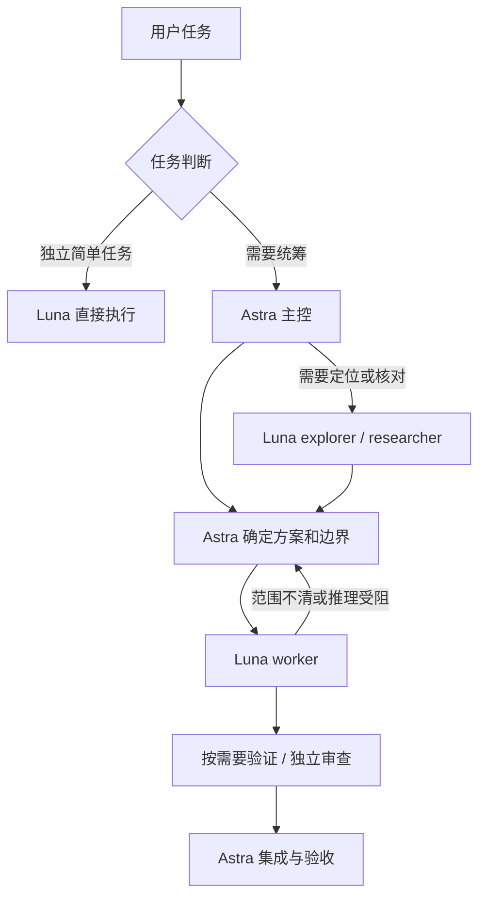

# ChatGPT Task Crew

让 ChatGPT / Codex 按任务分工：**Astra 负责判断、拆解和验收，Luna 负责明确、有边界的执行。**

这是一套从本机实际使用的现行部署整理出的 Codex 配置与 Skill。主配置、五个角色文件和 Skill 保留现行原文，并附安装说明及实际使用复盘。它利用 Codex 已有的子 Agent 能力，不需要另建调度服务。

默认模型为 `gpt-6-astra` + `gpt-6-luna`；用户选择 Sol 主控时也可沿用相同分工。仓库名包含 ChatGPT，是因为这些模型可通过相关产品使用；这里的 `.codex/` 文件面向支持本地配置的 Codex 客户端，不能直接安装到普通 ChatGPT 网页聊天中。本项目由个人维护，与 OpenAI 无官方隶属关系。

## 怎么分工

| 任务 | 建议处理方式 | 责任 |
|---|---|---|
| 独立的简单问答、格式整理、小范围修改 | 新会话直接选择 Luna | Luna 完成并给出必要验证 |
| Astra 会话中的琐碎一步操作 | 当前主 Agent 直接完成 | 避免交接成本超过执行成本 |
| 多文件工程、跨模块改动、先探索再实现、实现与验证分离 | 按现行 Skill 委派门槛实际派发 Luna | 主 Agent 给清楚边界并验收 |
| 存在独立工作流的复杂任务 | Astra 拆解，Luna 分别执行 | Astra 负责依赖、冲突与集成 |
| 架构取舍、需求歧义、跨模块决策 | Astra 主控 | 先做决定，再派执行任务 |
| 有实际收益的独立审查 | Astra reviewer | 只读检查真实改动与证据 |

现行 Skill 对符合委派门槛的任务要求至少一次真实子 Agent 派发，琐碎单文件修改和简单问答除外。**至少一次委派不等于每次启动全部角色。** 并行要有独立的输入、输出和文件所有权，测试跟在对应实现之后。

### Luna 受阻时

- 主控为 Astra：先判断能否补上下文或缩小任务；确需升级时，按现行协议取得用户授权后派发 `gpt-6-sol` / `high`。同一任务已授权的同类升级不重复询问。
- 主控为 Sol：主控补上下文或直接接管受阻部分，不再启动 Sol 子代理或提出升级申请。
- 委派、升级、保持 Luna、接管和完成均在对话中简要标明，禁止静默换模型。

上述双支路原文针对 `gpt-6-astra` / `gpt-6-sol`。实际记录中也出现 `gpt-6.1-sol` 主控；它证明同类角色分工有使用记录，但现行 Skill 尚未显式定义该型号的受阻支路，不把它写成已完成的规则更新。



## 仓库内容

```text
templates/project/
  AGENTS.md                              合并到项目入口的简短规则
  .codex/config.toml                     Astra 主控与 Luna 默认子代理
  .codex/agents/{explorer,worker,tester,researcher,reviewer}.toml
  .agents/skills/astra-orchestrator/SKILL.md
docs/
  installation.md                        安装、已有配置合并与回滚
  usage-review.md                        本机实践、证据边界和整理改动
  runtime-verification.md                实际模型和委派的验收方法
  deployment-manifest.json               七个现行部署文件的 SHA-256
examples/delegation.md                   可以直接改写使用的任务契约
scripts/check_bundle.py                  无第三方依赖的静态检查
```

文件放在 `templates/project/` 下，所以打开本仓库不会自动改动当前会话模型。安装时把模板合并进目标项目，完整步骤见 [installation.md](docs/installation.md)。

## 开始使用

1. 确认客户端提供子 Agent 工具、项目级配置和需要的模型；本地配置不能给账户增加模型权限。
2. 备份目标项目已有的 `AGENTS.md`、`.codex/` 和同名 Skill；合并模板，而不是覆盖整个项目规则。
3. 在 Codex 中打开目标项目，新建会话，在模型选择器确认主控模型。
4. 对复杂任务使用下面的提示，并按 [runtime-verification.md](docs/runtime-verification.md) 检查实际调用。

```text
使用 astra-orchestrator。
按现行 Skill 判断委派门槛。主 Agent 保留方案、集成和最终验收，
常规执行交给 GPT-6 Luna medium；需要独立审查时使用 Astra reviewer。
每个委派说明范围、文件所有权、输出和验收标准，并简要标明实际模型。
不要为琐碎操作开子 Agent；遇到共享文件或依赖关系时按顺序处理。
```

独立的简单任务直接在新会话选择 Luna。模板不会自动把正在运行的 Astra 会话切换成 Luna。

## 已验证到哪一步

截至 **2026-10-08**，本机存在项目级正式部署，并有 Luna 执行和 Astra 审查的真实记录。早期计算器验证里，主 Agent 实际是 Sol，两个子 Agent 实际是旧版本 Luna；不能把它写成完整 Astra 拓扑测试。

主配置、五个角色文件和 Skill 与 2026-10-08 核对的现行部署逐字节一致，包括默认 6 个子线程、委派门槛、模型分配和升级流程；校验值见 [deployment-manifest.json](docs/deployment-manifest.json)。项目入口 `AGENTS.md` 仅提取分工规则，未复制私有业务治理文件。**源项目运行证据不等于其他目标客户端已完成安装验证。** 静态检查与来源比对范围见 [usage-review.md](docs/usage-review.md)。没有经过配对实验的成本或耗时下降比例。

运行静态检查需要 Python 3.11 或更新版本：

```bash
python3 scripts/check_bundle.py
```

## 官方资料

- [子 Agent、模型选择与项目级角色文件](https://learn.chatgpt.com/docs/agent-configuration/subagents)
- [OpenAI 模型目录](https://developers.openai.com/api/docs/models)

模型名、配置字段和客户端支持可能变化；记录中的日期和版本属于当时的实际情况。模型可用性和权限以当前账户、客户端及会话运行结果为准。
